# PwedePa design decisions

This file holds the settled calls. Update it in the same change that changes a
pick.

## Renders

Each picture is a generic wireframe, not a screenshot. It shows the shape a
rule adds.

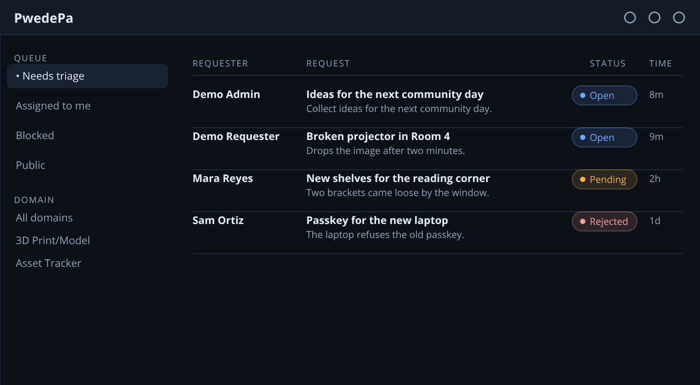

*Figure 1. The workspace reads as one table, with the rail on the left and a status pill that pairs a dot with a word.*

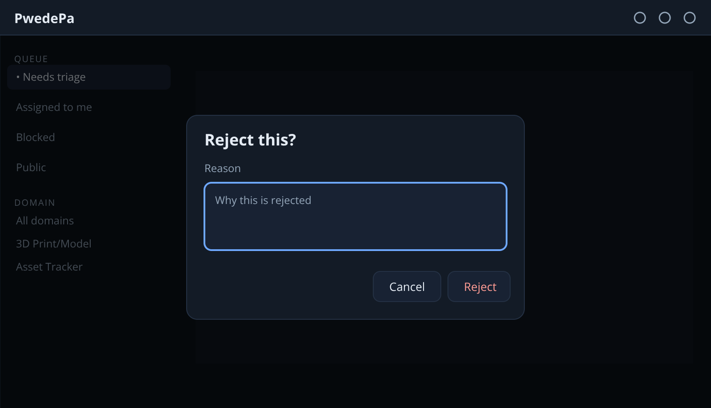

*Figure 2. A destructive move asks for one reason in a dialog, and Cancel and the scrim close it without a change.*

## Product shape

- Staff screens use the dense work-queue shape: top bar, queue filters, item list,
  inspector. No sidebar.
- Admin home lists its four sections as dense rows, each with one line of what it
  holds.
- Admin users, share links, and the audit log read as dense rows. A person or a
  Domain row opens in place for its controls.
- The notifications inbox reads as one flat list, newest first. Each row holds its
  message, who did it, the time, and one dismiss button.
- The staff workspace is the one staff page. It follows Gmail: one flat table of
  requests, no group headings. Unread rows sit first and read bold, and each staff
  member keeps their own read list. One toolbar over the table holds the title, the
  status filter, and the Issues link. New request sits in the top bar as an icon,
  because staff triage and clients make requests. The open row carries an accent
  edge on its first cell. The opened request replaces the list in the main column,
  and the rail stays, as Gmail reads a message. It carries the same view as its
  page, with state controls, the comment box, and sharing. A Back arrow returns
  to the filtered table, and a pencil opens the edit form. A staff link to a request opens the
  workspace instead of the record page. Clients keep the record page.
- Request and issue pages follow the GitHub issue shape. The title carries the
  number and the state. One comment timeline holds the description and the
  comments. A right sidebar holds the people, labels, priority, and details.
- Prose blocks read as markdown with inline html, the way a mail client reads a
  message. A sanitizer drops every unsafe tag, attribute, and url scheme.
- A reject asks for a reason, in one dialog. Cancel, Escape, and the
  scrim close it, and focus returns to the trigger. The reason box reuses the
  shared field rule, so it matches every other form.
- Archive, Remove announcement, and Revoke passkey ask for a reason in that same
  dialog. Clear all asks once and carries no reason.
- The public share page keeps that shape. It holds one timeline and a facts
  sidebar, and no write control.
- The Issues page groups issues by state. A row shows the number, title, priority, and
  assignee, and an empty state group stays out of the list.
- A client sees a mini dashboard at the top of the Requests page. Their own requests
  and the public board read as dense rows, each with its state and a card link. A
  selected item opens as the wide card, and a phone shows it alone. The client
  surface stays one 720 px column.
- Settings follow the Apple Settings pattern: grouped rows, label left, control
  right, and a chevron only when the row navigates. The pattern stays inside Settings.
  A wide screen works like the Mac pane: the rail picks one group and only that
  group shows. A phone stacks every group, as iOS does. A switch saves the moment
  it flips, so a group of switches carries no Save button.
- Text size sets the page type from 85 to 130 percent, with a slider and a
  number for the exact value.
- Admin is one group in Settings, and the group stays hidden for non-admins.

## Domains

- `config.yml` seeds the Domains once. After that the app owns the list, and an
  admin adds, renames, or removes a Domain in Admin, Domain config. A rename keeps
  the records, and the old slug answers with a redirect. A remove drops the
  Domain's records behind a confirm that counts them.
- An admin imports a picked file in Admin, Domain config. The app reads that copy
  before the config file in force.
- A request lives at `/<slug>/requests/<id>` and an issue at `/<slug>/issues/<id>`.
  The old `/<id>` pages answer 404, and both forms offer the configured Domains.
- The Domain page shows the description, its requests and issues, and its
  announcements newest first. The records read as dense rows with a state, and a
  phone stacks each row. An announcement holds a title, a body, the author, the
  publish time, and the edit time.
- The slug keys an announcement and a subscription, so a rename keeps both. A pinned
  slug keeps the URL too.
- A person follows a Domain from a toggle on its page. A new announcement notifies
  each follower except the author, and the activity switch silences it.
- Staff remove an announcement from a dialog that asks first.

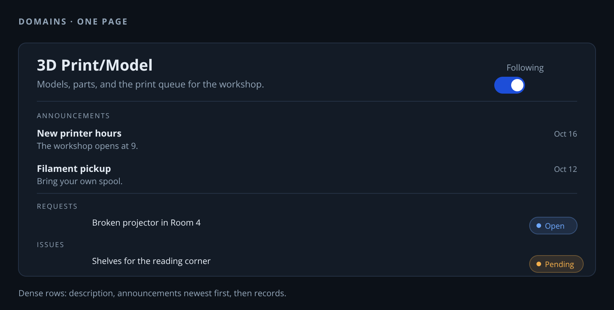

*Figure 3. The Domain page holds the description, the announcements newest first, and the records as dense rows.*

## Settings file

- `config.yml` is a template, and a deploy mounts the real file over it. It holds
  the Domains and three short keys: `database`, `origin`, and `rp_id`. The dev file
  adds `seed`. A key in the file wins over its environment variable.
- `config.dev.yml` sits beside `config.yml`, and the app reads it whole in place of
  that file. No variable turns it on, and the released image ships without it.
- A `seed:` list fills the requests and issues tables once, on a first start, and
  only while both are empty.

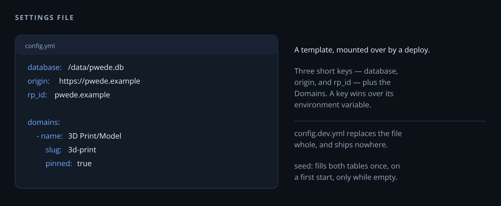

*Figure 4. `config.yml` holds three short keys and the Domains, and a deploy mounts the real file over it.*

## Color

Scheme 2, Slate and blue. Components use tokens from
`pwedepa/web/static/tokens.css` and never raw hex.

| Token | Light | Dark |
| --- | --- | --- |
| bg | `#F4F6F8` | `#0C1118` |
| surface | `#FFFFFF` | `#131B26` |
| surface-2 | `#F8FAFC` | `#182233` |
| line | `#DCE3EA` | `#243144` |
| text | `#17222E` | `#E4EBF3` |
| muted | `#5B6B7B` | `#93A5B8` |
| accent | `#2563EB` | `#6EA8FE` |
| accent-fill | `#2563EB` | `#1D4ED8` |
| danger | `#DC2626` | `#FF9C94` |
| warn | `#B45309` | `#F5B04C` |
| ok | `#15803D` | `#6FD598` |

- Status colors stay constant across schemes: Open blue, Pending amber, Delayed
  violet, Blocked red, Resolved green, Closed gray.
- A status pill pairs a dot with a word, so color never carries the meaning alone.
- Body text passes 4.5:1 contrast, large text 3:1, and every interactive element
  shows a 2 px focus ring.

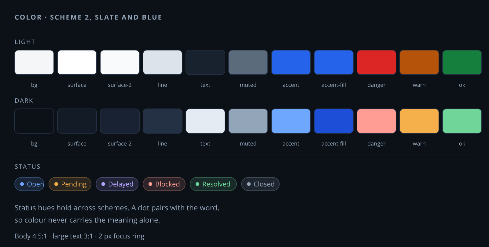

*Figure 5. Eleven tokens carry both schemes, and a status pill pairs a dot with a word.*

## Type

- Inter, self-hosted woff2 in 400, 600, and 800, under the SIL Open Font License 1.1.
- IDs, counts, and ages use the ui-monospace stack with tabular figures.
- Scale: 11 px uppercase eyebrows, 12 px meta, 15 px body, 20 px panel titles, and
  28 px page titles.

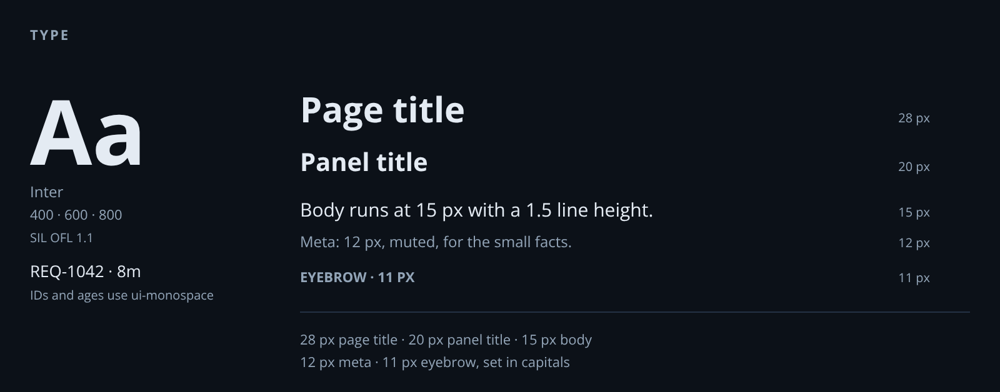

*Figure 6. Inter runs from the 28 px page title to the 11 px eyebrow, and IDs use tabular figures.*

## Icons

- Lucide, as one self-hosted SVG sprite at 18 px in the current text color.
- The app icon is the Google Noto Emoji pleading face. The licenses ship beside both
  assets, and the icon files and their `NOTICE.md` live in
  `pwedepa/web/static/icons/`.

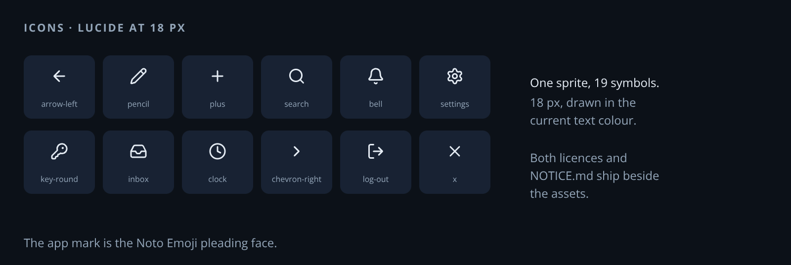

*Figure 7. One sprite gives every icon at 18 px in the current text colour.*

## Layout

- The top bar is 56 px, fixed outside the scrolled layer, and the body holds its room.
- Tabs follow the role. Staff hold no tabs, and the brand opens the workspace.
  Clients keep Requests and Issues.
- A staff member can switch the whole session to the client view from Settings.
  Request and issue pages lose the write controls, and the server refuses a
  request or issue write that still arrives. Account settings stay writable.
- At 1200 px and up the staff grid runs filters 240 px, list fluid, inspector 360 px.
  Spacing follows an 8 px scale, rows are 40 px, panels get 10 px radius, and panels
  carry no shadow.
- Breakpoints sit at 1200, 900, and 640 px. Below 900 px the tabs move to a bottom
  bar, the opened item fills the page, and the filters fold into one row.
- Touch targets run at least 44 px, and tables stack into cards on a phone.

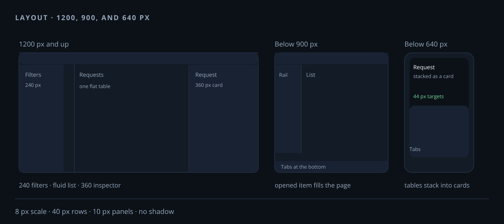

*Figure 8. The grid runs filters, list, and inspector at 1200 px, folds at 900 px, and stacks at 640 px.*

## Components

- One primary action per view. Primary buttons use the accent fill, and danger stays
  ghost style with red text.
- Forms put the label above the field, help text in 12 px muted, and errors in danger
  text that names the fix.
- Empty states use the pleading-face mark, one sentence, and one action.
- A new pattern needs a sheet entry and a screenshot before it ships.

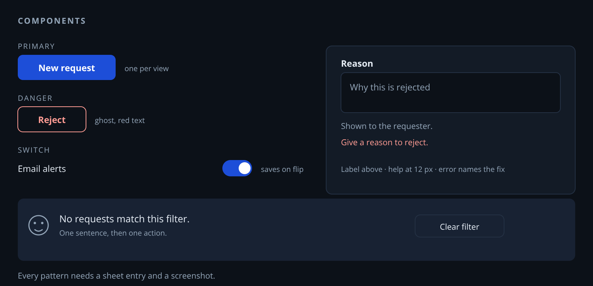

*Figure 9. One primary button, a ghost danger button, a labelled field, and an empty state with one action.*

## Theme and motion

- The theme control cycles System, Light, and Dark, and System reads the device. The
  choice lives on the account. Signed-out pages and the frozen demo keep a browser
  copy. An inline head script sets the theme before the first paint.
- One easing curve, `cubic-bezier(0.22, 1, 0.36, 1)`, runs 160 to 220 ms. Reduced
  motion turns animation off.
- The sign-in page holds one card and no header. The card offers a passkey button and an enroll link.

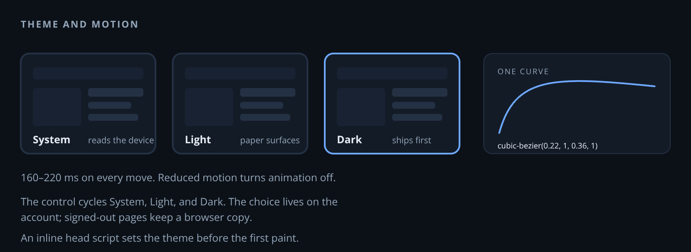

*Figure 10. The theme control cycles three choices, and one curve runs every move.*

## States

- A row lifts on hover only where a pointer exists.
- Every control shows a 2 px accent focus ring.
- Reduced motion turns animation off.
- An empty list says what is missing and offers one action.

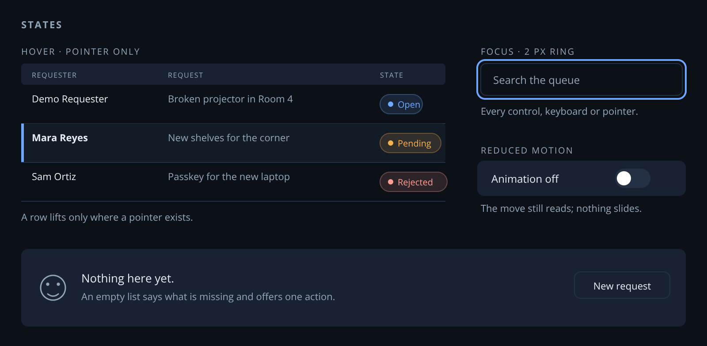

*Figure 11. A row lifts on hover, a control shows a 2 px ring, and an empty state offers one action.*

## Phone

- Below 900 px the opened record fills the page and the list steps back.
- Below 640 px the tabs move to a bottom bar, tables stack into cards, and the
  touch target stays at least 44 px.

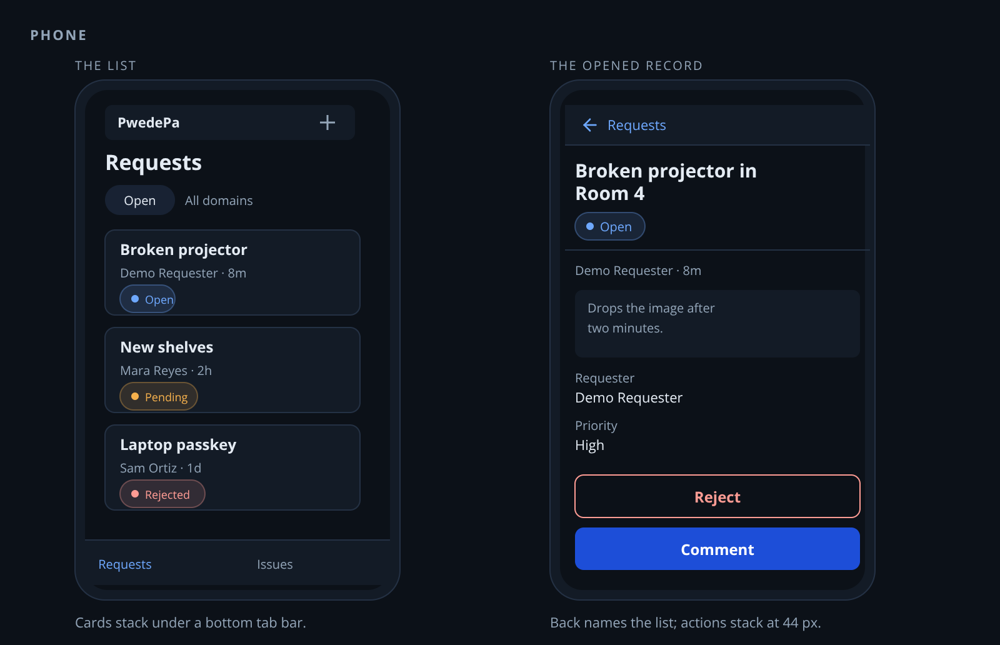

*Figure 12. A phone stacks the list as cards over a bottom tab bar, and the opened record fills the screen.*

## Change log

- 2026-10-17. The request action reads Reject, and a reason comes in a dialog.
- 2026-10-17. Archive, Remove announcement, and Revoke passkey ask for a reason.
- 2026-10-17. The workspace reads as one mail table with a reading pane.
- 2026-10-16. Dark theme ships first, and every shot uses it.

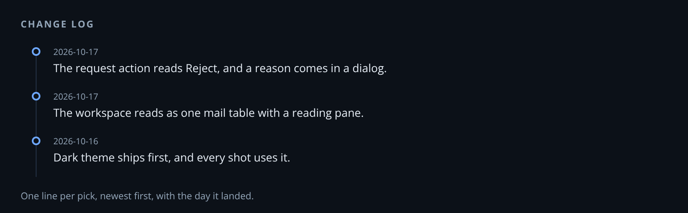

*Figure 13. The change log reads newest first, one line per pick.*
