# The database schema

`scripts/render_schema.py` generates this page from `docs/schema.dbml`. Do not edit this
page by hand. Edit the DBML and run the script.

The executable schema is `pwedepa/data/schema.sql`. `pwedepa/data/db.py` reads it once at
import, and `initialize()` runs each statement with `exec_driver_sql` the first time a
database path appears in the process.

`PRAGMA user_version` holds the number this code needs, and that number is 1. A 0.1.0 file
carries 0. `initialize()` runs step 1 over it, then stamps 1.

Step 1 adds `user_preferences.theme` when that column is missing. It also rebuilds
`enrollment_tokens` when the table still holds `user_id`, because a token now names a role
and not a person.

There is no migration tool and no ORM model. Alembic is not a dependency, so a schema change
reaches an old file only through a numbered step. A file from a newer release stops the app
with its path and the command to delete it.

```mermaid
---
config:
  layout: elk
---
erDiagram
    requests {
        integer id PK
        text title "NOT NULL"
        text description "NOT NULL"
        text status "NOT NULL"
        integer requester_id
        text priority_suggestion
        integer priority_unsure "NOT NULL, DEFAULT 0"
        text visibility "NOT NULL"
        text domains "NOT NULL, DEFAULT '[]'"
        text created_at
        text updated_at
        text deleted_at
    }
    issues {
        integer id PK
        text title "NOT NULL"
        text description "NOT NULL"
        text status "NOT NULL"
        integer source_request_id
        integer requester_id
        integer assignee_id
        text priority "NOT NULL"
        text visibility "NOT NULL"
        text domains "NOT NULL, DEFAULT '[]'"
        text created_at
        text updated_at
        text deleted_at
    }
    events {
        integer id PK "AUTOINCREMENT"
        text object_type "NOT NULL"
        integer object_id "NOT NULL"
        text event_type "NOT NULL"
        integer actor_id
        text at
        text data "NOT NULL, DEFAULT '{}'"
    }
    users {
        integer id PK "AUTOINCREMENT"
        text username "NOT NULL, UNIQUE"
        text display_name "NOT NULL"
        text status "NOT NULL"
        text created_at "NOT NULL"
        text updated_at "NOT NULL"
        text archived_at
    }
    user_roles {
        integer user_id "NOT NULL"
        text role "NOT NULL"
        text created_at "NOT NULL"
    }
    permission_grants {
        integer id PK "AUTOINCREMENT"
        integer user_id "NOT NULL"
        text permission "NOT NULL"
        text effect "NOT NULL"
        text created_at "NOT NULL"
        text revoked_at
    }
    passkeys {
        integer id PK "AUTOINCREMENT"
        integer user_id "NOT NULL"
        blob credential_id "NOT NULL, UNIQUE"
        blob public_key "NOT NULL"
        integer sign_count "NOT NULL"
        text created_at "NOT NULL"
        text last_used_at
        text revoked_at
    }
    webauthn_challenges {
        text id PK
        integer user_id
        text ceremony "NOT NULL"
        blob challenge "NOT NULL"
        text created_at "NOT NULL"
        text expires_at "NOT NULL"
        text used_at
    }
    enrollment_tokens {
        integer id PK "AUTOINCREMENT"
        text role "NOT NULL"
        text token_hash "NOT NULL, UNIQUE"
        text created_at "NOT NULL"
        text expires_at "NOT NULL"
        text used_at
    }
    sessions {
        integer id PK "AUTOINCREMENT"
        integer user_id "NOT NULL"
        text token_hash "NOT NULL, UNIQUE"
        text created_at "NOT NULL"
        text expires_at "NOT NULL"
        text last_used_at
        text revoked_at
        integer replaced_by_id
    }
    audit_events {
        integer id PK "AUTOINCREMENT"
        integer actor_id
        text event_type "NOT NULL"
        text object_type
        integer object_id
        text data "NOT NULL, DEFAULT '{}'"
        text created_at "NOT NULL"
    }
    share_links {
        integer id PK "AUTOINCREMENT"
        text object_type "NOT NULL"
        integer object_id "NOT NULL"
        text token_hash "NOT NULL, UNIQUE"
        text permissions "NOT NULL, DEFAULT '[]'"
        integer created_by_id "NOT NULL"
        text created_at "NOT NULL"
        text expires_at
        text revoked_at
        text view_consumed_at
    }
    notifications {
        integer id PK "AUTOINCREMENT"
        integer user_id "NOT NULL"
        text category "NOT NULL"
        text object_type
        integer object_id
        text message "NOT NULL"
        integer actor_id
        text created_at "NOT NULL"
    }
    notification_preferences {
        integer user_id "NOT NULL"
        text category "NOT NULL"
        integer enabled "NOT NULL, DEFAULT 1"
        integer inbox_enabled "NOT NULL, DEFAULT 1"
        integer pip_enabled "NOT NULL, DEFAULT 1"
    }
    user_preferences {
        integer user_id PK
        text clock "NOT NULL, DEFAULT '12'"
        text theme "NOT NULL, DEFAULT 'system'"
    }
    site_messages {
        integer id PK "AUTOINCREMENT"
        text message "NOT NULL"
        integer enabled "NOT NULL, DEFAULT 1"
        text created_at "NOT NULL"
        text updated_at "NOT NULL"
        text expires_at
        integer created_by_id
    }

    users ||--o{ requests : "requester_id"
    requests ||--o{ issues : "source_request_id"
    users ||--o{ issues : "requester_id"
    users ||--o{ issues : "assignee_id"
    users ||--o{ user_roles : "user_id"
    users ||--o{ permission_grants : "user_id"
    users ||--o{ passkeys : "user_id"
    users ||--o{ webauthn_challenges : "user_id"
    users ||--o{ sessions : "user_id"
    sessions ||--o{ sessions : "replaced_by_id"
    users ||--o{ share_links : "created_by_id"
    users ||--o{ notifications : "user_id"
    users ||--o{ notification_preferences : "user_id"
    users ||--o{ user_preferences : "user_id"
    users ||--o{ site_messages : "created_by_id"
```

## How to change a table

1. Edit `pwedepa/data/schema.sql` for a fresh database.
2. Raise `SCHEMA_VERSION` in `pwedepa/data/db.py`, and add one step that guards on the number
   it moves from, so a second run changes nothing.
3. Edit `docs/schema.dbml`, then run `python scripts/render_schema.py`.
4. Add a test that opens a database with the old shape, connects, and reads the new shape.
