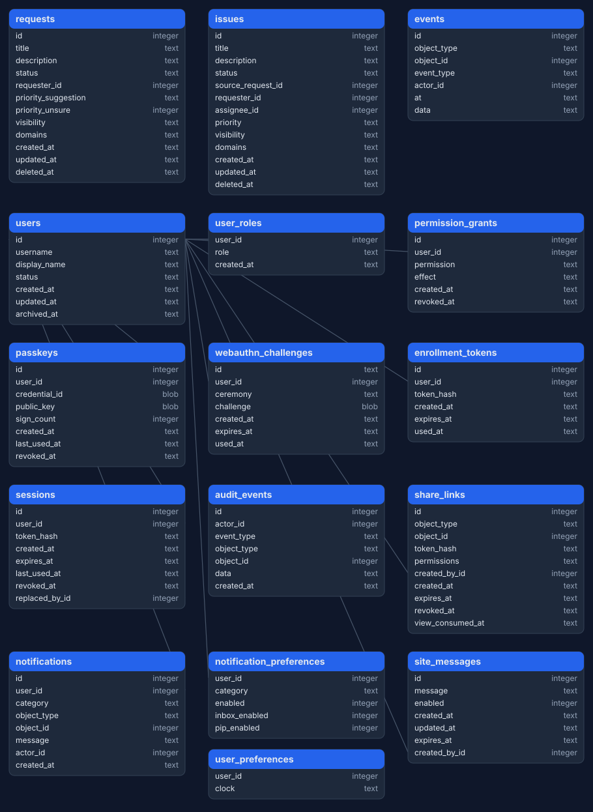

# Schema

One SQLite database holds records, auth, sharing, and notifications. SQLAlchemy opens it, and `pwedepa/data/schema.sql` carries the initial schema.

## Sources

- `pwedepa/data/schema.sql` is the truth. The app creates these tables on open.
- `docs/schema.dbml` renders the same shape at [dbdiagram.io](https://dbdiagram.io). Paste the file content into the editor.
- `docs/schema.svg` is the rendered diagram. Regenerate it after a schema change, and update the DBML in the same change.

## Change rules

- During hard development, edit `schema.sql` and recreate dev databases. No migration versions exist yet.
- Alembic ships as a dependency with zero migrations. The first migration lands when a schema change must keep live data.
- The `events` and `audit_events` tables keep polymorphic object references as plain columns. Every declared foreign key names its target table.
